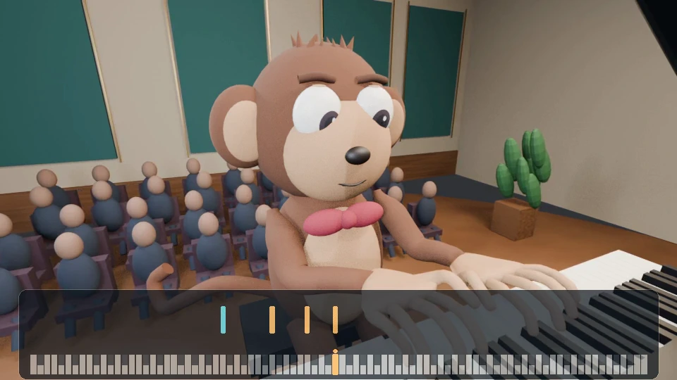

# Piano Performance Simulation

A project by **Gabe Argush**.

Piano performances built from interpreted musical events, coordinated hand and key motion, rendered scenes, and synchronized note visuals.

[Explore the website](https://gabegush.github.io/piano-simulation/) · [Earlier versions](https://gabegush.github.io/piano-simulation/work.html) · [Project updates](https://gabegush.github.io/piano-simulation/release-log.html)

## Winter Wind

The featured performance is Chopin’s *Winter Wind*, Op. 25 No. 11, presented as a complete 3:25 video. Choose the pianist, pianist with the note visualizer, or portrait format.

One playback clock connects the top video, the viewing formats, and the combined diagnostic. Persistent controls provide play, pause, sound, seeking, and playback speed while scrolling. Sound starts muted and can be enabled with **Hear piano**.

The combined view follows musical timing, pedal commands, finger assignments, planned key holds, and evaluated positions for all ten fingertips, including fingers moving between notes. Planned key holds, actual fingertip points, and intended held-contact targets share one keyboard built from the same physical key bounds, spacing, and orientation. Distinct fills and markers keep the planned and evaluated layers clear. Positions interpolate between recorded samples; contact indicators describe sampled pad-to-key geometry.

## From music to motion

Musical interpretation supplies timing, dynamics, fingering, and pedal. These events guide the hands, fingers, and moving keys in the rendered performance. The note visualizer follows the same performance timeline, with longer bars entering gradually. Earlier pieces and implementation examples are available on the [Earlier versions page](https://gabegush.github.io/piano-simulation/work.html).

## This repository

This repository contains the static public website, published media, and diagnostic data used by the showcase. Production scenes and the tools that create the performances are maintained separately.

- `index.html`: current performance and combined diagnostic.
- `work.html`, `evidence.html`, and `release-log.html`: earlier examples, source context, and dated updates.
- `entries.json`: release-log records.
- `app.js` and `media.js`: shared playback and media bindings.
- `performance-data.js`, `tip-data.js`, and `tip-view.js`: musical events, sampled fingertip geometry, and display interpolation.
- `key-layout.js`: the shared physical keyboard for planned holds, fingertips, and targets.
- `style.css` and `assets/`: presentation styles, images, and video.

There is no build step. For local preview, serve the repository root with a static web server.
