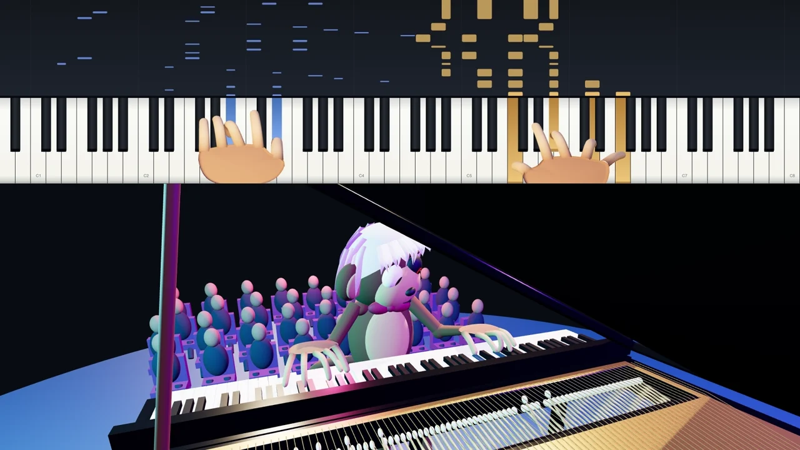

# Piano Simulation

An engineering case study in turning piano performance into articulated motion, rendered video, and reviewable revisions. Human direction sets the musical and visual goals; AI-assisted implementation connects note timing, hand movement, piano interaction, and production tooling.

[Explore the project showcase](https://gabegush.github.io/piano-simulation/) · [Watch the 88-second demo](https://gabegush.github.io/piano-simulation/#demo) · [Compare revisions](https://gabegush.github.io/piano-simulation/#iterations) · [Read project updates](https://gabegush.github.io/piano-simulation/release-log.html)

The showcase follows a performance from musical events through hand animation and rendering. It includes an 88-second engineering demo, matched before-and-after views, notes on the review process, and recorded release outcomes. The demo visuals and its illustrative soundtrack are identified separately on the site.

This repository hosts the **public showcase website**. The underlying production files and working pipeline are separate from this site.
